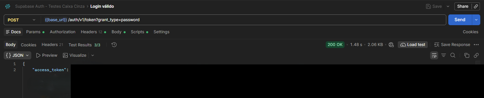
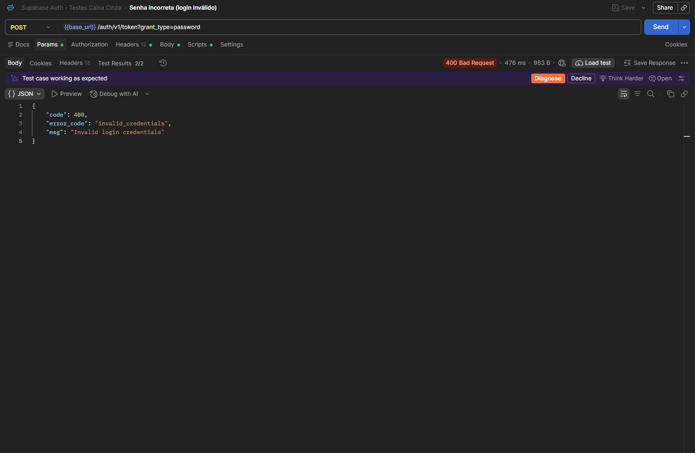
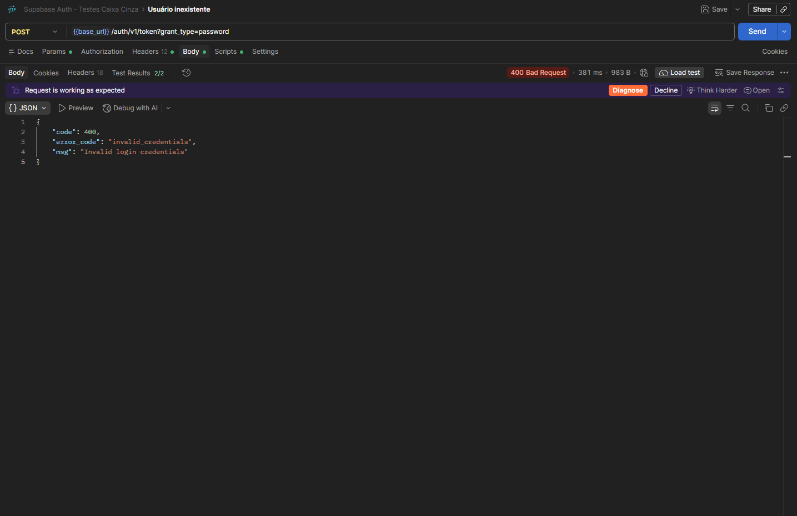
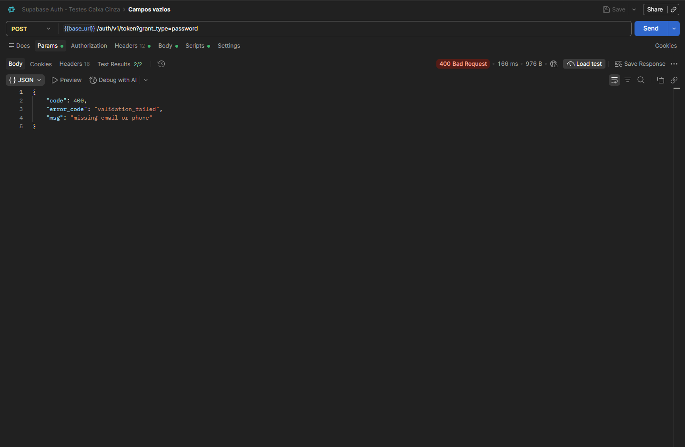
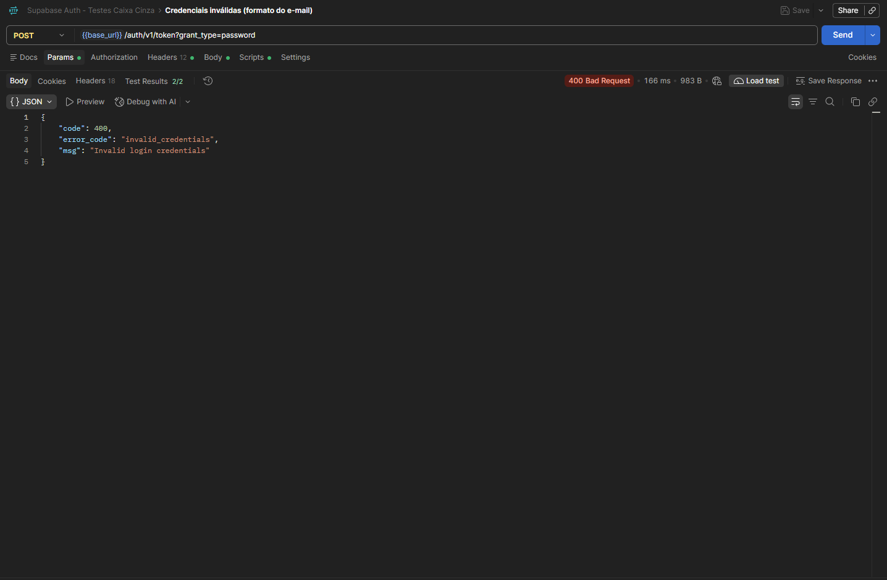
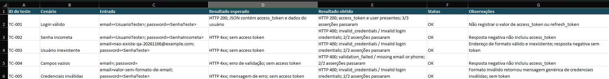

# Introdução

Este repositório documenta uma atividade acadêmica de testes caixa cinza da autenticação por e-mail e senha oferecida pelo Supabase Auth. A solução utiliza chamadas HTTP no Postman e registra cenários, critérios de aceitação e evidências.

> **Importante:** os cinco cenários foram executados pelo aluno no projeto Supabase. Este repositório não contém credenciais reais. Antes de publicar evidências, oculte chaves, senhas, e-mails pessoais, access tokens e refresh tokens.

## Sumário

- [Introdução](#introdução)
- [Objetivo da Atividade](#objetivo-da-atividade)
- [Configuração do Supabase](#configuração-do-supabase)
- [Configuração do Postman](#configuração-do-postman)
- [Configuração das Requisições](#configuração-das-requisições)
- [Execução dos Testes](#execução-dos-testes)
- [Registro dos Testes](#registro-dos-testes)
- [Resultados Obtidos](#resultados-obtidos)
- [Conclusão](#conclusão)

# Objetivo da Atividade

Validar, sob a perspectiva de caixa cinza, o fluxo de autenticação por senha do Supabase. O teste considera o contrato HTTP, os cabeçalhos, o corpo JSON e os resultados esperados para credenciais válidas e inválidas. O acesso parcial às configurações do serviço permite relacionar as observações da API ao mecanismo de autenticação sem inspecionar sua implementação interna.

**Escopo:** autenticação de usuário existente por e-mail e senha no endpoint de token. Não inclui cadastro, recuperação de senha, MFA, autorização de recursos nem testes de carga.

# Configuração do Supabase

## Criar conta e projeto

1. Acesse [supabase.com](https://supabase.com/) e crie uma conta ou entre com uma conta existente. Confirme o e-mail, se solicitado.
2. No Dashboard, selecione **New project**, escolha a organização e informe nome, senha forte para o banco e região. Guarde a senha do banco em local seguro; ela não é a senha do usuário de teste.
3. Aguarde a criação e inicialização do projeto. Abra o projeto pelo Dashboard e confirme que ele está ativo.
4. Para a evidência, use a tela do projeto sem exibir segredos ou informações pessoais desnecessárias.

## Habilitar autenticação por e-mail

1. No projeto, abra **Authentication** e localize a configuração de provedores/sign-in.
2. Habilite o provedor **Email**. Os rótulos podem variar com a versão do Dashboard.
3. Revise as opções de confirmação de e-mail. Se a atividade exigir login imediato, configure o fluxo de confirmação de acordo com as regras da disciplina e registre essa decisão. Em produção, não desabilite confirmação sem uma justificativa de segurança.

## Criar usuário de teste

1. Em **Authentication > Users**, selecione a opção para adicionar/criar usuário.
2. Informe um e-mail de teste controlado pelo aluno e uma senha exclusiva para a atividade. Confirme o e-mail conforme a configuração do projeto.
3. Não reutilize senhas pessoais e não inclua os valores reais no repositório. Nos artefatos, use `<UsuarioTeste>` e `<SenhaTeste>` como marcadores a substituir localmente.
4. Anote apenas identificadores não sensíveis necessários à evidência. Remova/limpe o usuário de teste quando a atividade terminar, se apropriado.

## Localizar URL e chave da API

1. No Dashboard, abra **Project Settings > API** (ou a seção equivalente de API/Connect).
2. Copie a **Project URL** para `base_url`. Ela se parece com `https://<project-ref>.supabase.co`.
3. Use a chave pública apropriada ao cliente, normalmente a **publishable key** ou a chave legada `anon`, conforme o projeto e a orientação vigente do Supabase. Esta atividade envia a chave em `apikey`; não use `service_role` nem outra chave secreta no Postman ou no GitHub.
4. Mantenha valores reais somente no Environment local do Postman, fora do controle de versão. Os arquivos deste repositório usam placeholders.

## Objetivo da autenticação

A autenticação verifica se as credenciais apresentadas pertencem a um usuário e, em caso de sucesso, emite tokens de sessão. O access token identifica a sessão em chamadas autorizadas subsequentes; deve ser tratado como segredo temporário e nunca publicado em evidências.

### Evidências do Supabase

Substitua cada placeholder pela captura correspondente. Antes de publicar, oculte e-mails pessoais, URLs sensíveis quando aplicável, chaves, senhas, tokens e identificadores não necessários.

| Evidência | Arquivo sugerido |
|---|---|
| Projeto criado | `prints/supabase/painel-supabase.png` |
| Painel do Supabase | `prints/supabase/painel-supabase.png` |
| Autenticação por e-mail habilitada | `prints/supabase/autenticacao-email.png` |
| Usuário de teste criado | `prints/supabase/usuario-teste.png` |
| Página de credenciais da API, com valores ocultos | `prints/supabase/credenciais-api-ocultas.png` |
| Identificação do aluno (somente dados exigidos pela disciplina) | `prints/supabase/identificacao-aluno.png` (pendente, se exigida separadamente) |

# Configuração do Postman

## Instalação

Instale o Postman Desktop a partir do [site oficial](https://www.postman.com/downloads/) ou utilize a versão web. Entre ou crie uma conta conforme necessário.

## Workspace

Crie um workspace com o nome `Testes Caixa Cinza - Supabase Auth`. Importe `postman/collection.json` e `postman/environment.json` pelo recurso **Import**. Mantenha a Collection e o Environment organizados em uma pasta ou workspace dedicado.

## Environment e variáveis

Selecione o Environment importado e substitua os placeholders apenas na cópia local. Não sincronize nem publique valores reais. Se o Postman oferecer valores **Initial** e **Current**, deixe segredos apenas em **Current** e não compartilhe esse Environment.

| Variável | Valor inicial no arquivo | Finalidade |
|---|---|---|
| `base_url` | `<SUA_URL>` | URL base do projeto Supabase, por exemplo `https://<project-ref>.supabase.co`; sem barra final. |
| `api_key` | `<SUA_API_KEY>` | Chave pública publishable/anon usada no cabeçalho `apikey`. Nunca substitua por `service_role`. |
| `email` | `<UsuarioTeste>` | E-mail real do usuário de teste, definido localmente no Postman. |
| `password` | `<SenhaTeste>` | Senha real do usuário de teste, definida localmente no Postman. |

A variável `Authorization` é montada em cada requisição como `Bearer {{api_key}}`; ela não precisa ser cadastrada separadamente.

### Evidências do Postman

| Evidência | Arquivo sugerido |
|---|---|
| Workspace criado | `prints/postman/workspace.png` |
| Environment selecionado | `prints/postman/environment.png` |
| Variáveis configuradas, valores sensíveis ocultos | `prints/postman/environment.png` |
| Collection e requisições organizadas | `prints/postman/environment.png` |

# Configuração das Requisições

## Endpoint e método

- **Método:** `POST`
- **Endpoint:** `/auth/v1/token?grant_type=password`
- **URL completa:** `{{base_url}}/auth/v1/token?grant_type=password`
- **Objetivo:** enviar e-mail e senha para o Supabase Auth e solicitar a emissão de tokens de sessão.

`grant_type=password` indica o fluxo de autenticação por senha. O corpo deve ser JSON e conter as credenciais do usuário.

## Headers

| Header | Exemplo | Finalidade |
|---|---|---|
| `apikey` | `{{api_key}}` | Identifica a chave pública do projeto/cliente que faz a chamada. |
| `Authorization` | `Bearer {{api_key}}` | Envia a chave no formato Bearer, conforme o contrato da API. |
| `Content-Type` | `application/json` | Informa que o corpo da requisição está em JSON. |

Exemplo após substituir localmente os placeholders (não use valores reais em documentação pública):

```http
POST {{base_url}}/auth/v1/token?grant_type=password
apikey: {{api_key}}
Authorization: Bearer {{api_key}}
Content-Type: application/json
```

## Body JSON

Para o login válido, selecione **Body > raw > JSON**:

```json
{
  "email": "{{email}}",
  "password": "{{password}}"
}
```

Exemplo ilustrativo do formato, não de uma credencial funcional:

```json
{
  "email": "usuario@email.com",
  "password": "123456"
}
```

O usuário de teste deve ser criado previamente no projeto. Para os cenários negativos, a Collection substitui os valores por senha incorreta, e-mail inexistente ou campos vazios. As respostas e mensagens exatas podem variar conforme a versão/configuração do Supabase; valide status e corpo retornados no ambiente real.

### Evidência da requisição

As capturas da configuração da requisição usam placeholders e não expõem credenciais:

- Endpoint e body JSON: `prints/postman/requisicao-login.png`
- Headers: `prints/postman/headers.png`

# Execução dos Testes

## Procedimento

1. Preencha `base_url`, `api_key`, `email` e `password` no Environment local e selecione esse Environment.
2. Confirme que o usuário de teste existe e está apto a autenticar (inclusive quanto à confirmação de e-mail).
3. Execute cada requisição da Collection individualmente ou pelo **Collection Runner**. Para o cenário de login válido, confirme o uso do usuário e senha corretos.
4. Compare status HTTP e JSON com os critérios abaixo. Registre o resultado real e a data de execução na planilha; não marque um cenário como aprovado apenas porque a resposta corresponde ao esperado neste documento.
5. O teste de login válido devolve tokens. Não copie o access token para o README, CSV, capturas públicas ou issues.

## Cenários e resultados

Os resultados abaixo foram observados em **06/11/2026**, usando Postman Desktop e o projeto Supabase configurado para a atividade. Credenciais estão representadas por placeholders. Os testes de resposta da Collection passaram em todos os cenários.

| Cenário | Entrada Utilizada | Resultado Esperado | Resultado Obtido | Status |
|----------|----------|----------|----------|----------|
| Login válido | `email=<UsuarioTeste>`; `password=<SenhaTeste>` | HTTP `200`; JSON com `access_token`, `token_type` e dados do usuário. | HTTP `200`; `access_token` e `user` presentes; 3/3 asserções passaram. | OK |
| Senha incorreta | `email=<UsuarioTeste>`; `password=<SenhaIncorreta>` | Erro HTTP `4xx`; sem access token. | HTTP `400`; `invalid_credentials` / `Invalid login credentials`; 2/2 asserções passaram. | OK |
| Usuário inexistente | `email=nao-existe-qa-20261106@example.com`; senha de teste | Erro HTTP `4xx`; sem access token. | HTTP `400`; `invalid_credentials` / `Invalid login credentials`; 2/2 asserções passaram. | OK |
| Campos vazios | `email=""`; `password=""` | Erro HTTP `4xx`; corpo JSON de validação/autenticação; sem token. | HTTP `400`; `validation_failed` / `missing email or phone`; 2/2 asserções passaram. | OK |
| Credenciais inválidas | `email=valor sem formato de e-mail`; senha de teste | Erro HTTP `4xx`; mensagem de validação/autenticação; sem token. | HTTP `400`; `invalid_credentials` / `Invalid login credentials`; 2/2 asserções passaram. | OK |

### Interpretação das respostas

- **HTTP status:** `200 OK` indica autenticação aceita. Para entradas inválidas, espera-se uma resposta `4xx`; o código específico depende da validação e da configuração do serviço. Um `5xx` indica erro do serviço e deve ser investigado, não classificado como falha de credencial.
- **JSON de sucesso:** normalmente contém `access_token`, `token_type`, `expires_in`, `refresh_token` e informações do usuário. Os campos podem evoluir. Registre somente a presença/ausência e metadados não sensíveis, nunca o valor do token.
- **JSON de erro:** contém informações de erro, como `message` e/ou `error_description`. A redação pode variar. Verifique que nenhuma resposta negativa inclui token de acesso.
- **Access Token:** credencial bearer temporária. Trate como segredo; não o salve em planilhas, logs, prints ou repositório público.

### Evidências dos testes

As cinco capturas reais estão em `prints/testes/`. A captura do login válido oculta o valor do token por uma tarja opaca. Não publique versões sem redação.

<details>
<summary>Login válido - HTTP 200, 3/3 asserções</summary>


</details>

<details>
<summary>Senha incorreta - HTTP 400, 2/2 asserções</summary>


</details>

<details>
<summary>Usuário inexistente - HTTP 400, 2/2 asserções</summary>


</details>

<details>
<summary>Campos vazios - HTTP 400, 2/2 asserções</summary>


</details>

<details>
<summary>Credenciais inválidas - HTTP 400, 2/2 asserções</summary>


</details>

# Registro dos Testes

O arquivo [planilha/registro_testes.xlsx](planilha/registro_testes.xlsx) e sua versão [planilha/registro_testes.csv](planilha/registro_testes.csv) contêm os cinco cenários e as colunas de registro solicitadas: ID do teste, cenário, entrada, resultado esperado, resultado obtido, status e observações.

Os cinco cenários foram registrados com os resultados observados, e as capturas dos testes estão incorporadas acima. A captura real da planilha preenchida também foi adicionada:

<details>
<summary>Planilha preenchida - cinco cenários</summary>


</details>

Não publique capturas que revelem e-mails pessoais, chaves, senhas, access tokens ou refresh tokens.

# Resultados Obtidos

**Situação desta versão:** os cinco cenários foram executados pelo aluno no Postman Desktop contra o projeto Supabase. O login válido retornou `200 OK`, com `access_token` e `user` na resposta. Os quatro cenários negativos retornaram `400 Bad Request`, sem emissão de access token. As asserções da Collection passaram: 3/3 para login válido e 2/2 em cada caso negativo.

As respostas negativas foram: `invalid_credentials` / `Invalid login credentials` para senha incorreta, usuário inexistente e formato de e-mail inválido; e `validation_failed` / `missing email or phone` para campos vazios. As capturas sanitizadas dos testes, a planilha preenchida e as evidências de configuração do Supabase e Postman estão nas pastas correspondentes. Uma captura separada de identificação completa do aluno no Supabase pode ser adicionada se a disciplina exigir esse item de forma específica.

# Conclusão

A atividade validou o endpoint de autenticação por senha do Supabase nos cinco cenários propostos. O login válido funcionou e retornou `200 OK` com token e usuário; as entradas negativas foram rejeitadas com respostas `400` sem token. A Collection confirmou os critérios por meio de suas asserções automatizadas.

A principal dificuldade foi configurar corretamente as variáveis e credenciais no Postman e distinguir respostas negativas esperadas de falhas na execução. Os testes não identificaram aceitação indevida de credenciais nem emissão de token nos cenários negativos. Como melhorias futuras, recomenda-se avaliar confirmação de e-mail, expiração e renovação de tokens, além de rate limiting em ambiente autorizado. Testes caixa cinza são importantes em APIs porque combinam conhecimento de configuração e contrato com observação externa para validar integração, controles de acesso e tratamento de erros sem exigir inspeção completa do código-fonte. As evidências dos testes, Supabase e Postman, além da captura da planilha, estão organizadas no repositório; antes de publicar, confirme se a disciplina exige uma captura separada de identificação do aluno.
